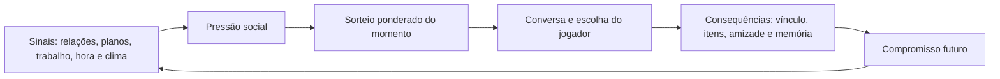

# Diretor social da Vila

Este documento é a base para ampliar a automação social da Vila. Ele descreve a intenção de design, a fórmula de seleção e o formato de novos acontecimentos. A implementação continua em `src/core/village/social.ts`; regras sem interface permanecem puras e testáveis.

## Objetivo

A Vila deve parecer uma comunidade: moradores trabalham, fazem planos, criam vínculos, erram, conversam e lidam com as consequências. O jogador observa ou intervém, mas não recebe punições irreversíveis por um sorteio invisível.

Um evento negativo precisa sempre ter:

- uma causa que faça sentido no contexto ou no histórico social;
- uma consequência legível no Diário e nas relações;
- ao menos uma saída de reparação, imediata ou por compromisso futuro;
- custo pequeno e proporcional quando o jogador usa um item;
- variação de elenco, lugar, horário e personalidade.

## Ciclo de vida



Os compromissos atuais são `visitar`, `ajudar` e `convidar`. Eles têm prioridade no próximo sorteio compatível, tornando uma promessa uma ação observável em vez de uma frase solta.

## Fórmula de pressão social

Para uma futura evolução, calcule uma pontuação de 0 a 100 antes do sorteio:

```text
pressão = limitar(0, 100,
  28 × pares brigados
  + 8 × pares com vínculo ≤ -12
  + 5 × dramas ou rivalidades nas últimas 24 h
  + 4 × compromissos vencendo nas próximas 24 h
  + 6 × incidentes de trabalho ou colheita não resolvidos
)
```

Use-a para ajustar o peso, sem substituir as condições de cada evento:

```text
peso final = peso base × novidade × anti-repetição × multiplicador do tipo

novidade       = 1,8 se o jogador nunca viu o evento; 1 caso contrário
anti-repetição = 0,1 se o evento estiver entre os últimos oito; 1 caso contrário

drama/rivalidade: 0,60 + 1,15 × pressão/100  (0,60–1,75)
amizade:          1,12 - 0,15 × pressão/100  (0,97–1,12)
outros tipos:     1,00
```

`pickMoment` segue a parte essencial da fórmula: drama e rivalidade têm peso menor quando não há tensão e maior quando existe ao menos uma relação rompida ou negativa. Os modelos de trabalho leem `SocialEnv.recentWork`, formado somente por registros concluídos em `state.farm.history`.

## Formato de evento

Crie modelos em grupos temáticos, por exemplo `INTRIGUE_MOMENTS`, com o tipo `Template` já existente:

```ts
{
  id: 'tri-exemplo',
  kind: 'drama',
  cast: 3,
  weight: 5,
  when: (ctx) => /* causa verificável */,
  lines: (ctx) => /* falas curtas e claras */,
  outcome: /* consequência se não houver decisão */,
  choice: {
    prompt: 'Pergunta concreta para o jogador',
    options: [
      { label: () => 'Reparar', outcome: { bond: 5, plan: { kind: 'visitar', days: 2 } } },
      { label: () => 'Dar espaço', outcome: { bond: -1, plan: { kind: 'ajudar', days: 3 } } },
    ],
  },
}
```

## Próximas levas recomendadas

1. **Trabalho visível:** expor no `SocialEnv` o local e a etapa do turno de cada morador; gerar conflitos por ferramenta, atraso, divisão de coleta e mérito. A primeira camada já usa as tarefas concluídas em `recentWork`; nunca inventa loot: o evento só comenta uma tarefa realmente registrada.
2. **Rumores persistentes:** criar um registro limitado de rumor com autor, alvo e validade. Um boato confirmado pode virar pedido de desculpas; um desmentido deve encerrar o rumor.
3. **Recuperação emocional:** depois de dois eventos negativos do mesmo par, aumentar eventos de conversa, ajuda ou visita até que haja uma decisão que estabilize a relação.
4. **Histórias em capítulos:** usar `SocialPlan` para encadear no máximo três cenas. O Diário deve nomear o capítulo e mostrar que o próximo encontro foi marcado.
5. **Reação espacial:** executar os momentos perto da praça, casa, fazenda, mina, madeireira ou lago conforme a causa. A lógica precisa apenas fornecer o contexto; a animação fica em `VillageView.vue`.

## Limites de segurança e ritmo

- Não aplicar perda de moeda, item único, cosmético ou relacionamento permanente sem escolha clara.
- Um mesmo par não deve receber dois eventos negativos seguidos.
- Uma colheita só pode ser consumida se ela existir e estiver madura; use `eatCrop`.
- Um compromisso expira após poucos dias e é removido quando concluído.
- Eventos ausentes da Vila resolvem a consequência padrão, portanto a consequência padrão deve ser leve.
- Cada novo modelo precisa passar por `sceneOfTemplate`, `resolveScene` e pelo catálogo em `social.test.ts`.

## Eventos inaugurais

Esta leva introduz `Boato na praça`, `Quem fez o trabalho?`, `A colheita sem dono`, `Promessa atrasada`, `A ferramenta sumida`, `Depois do turno`, `Mérito do turno`, `Pedido de folga`, `A porta aberta`, `O recado trocado` e `Três bancos no lago`. A leva cinematográfica acrescenta `Abrigo na chuva`, `A carta trocada`, `O tribunal da fruta`, `Dupla improvável`, `O último banco`, `A coroa de papel`, `Fuga do piquenique`, `Um pequeno heroísmo`, `Final do expediente` e `O segredo revelado`. Eles deixam memórias, mudam vínculos e, nas saídas construtivas, agendam visita, ajuda ou convite. Assim o jogo passa a ter conflito, humor, reparação e continuidade na mesma camada social.

